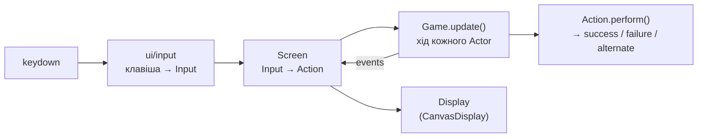

# ДНО

Покрокова roguelike-гра в браузері з процедурною генерацією підземель: десять поверхів униз, крізь власні нав'язливі думки.
Семестровий проєкт з дисципліни JavaScript — [Lab 26: Procedural Roguelike](https://github.com/rmalkevy/Programming-Practice-Projects/blob/main/labs/lab-26-procedural-roguelike.md) програми «42».

**▶ Грати:** https://old7evenn.github.io/roguelike/

> Кожен забіг має **seed**. Однаковий seed — однакове підземелля на всіх 10 поверхах.
> Посилання виду `…/?seed=1234` можна надіслати другу, і він пройде ті самі поверхи.

## Керування

| Клавіша | Дія |
|---|---|
| WASD / стрілки | рух |
| `.` або пробіл | пропустити хід |
| Enter | почати гру |
| N | новий забіг з випадковим seed |

## Запуск локально

```bash
nvm use        # Node 24 (.nvmrc)
npm install
npm run dev    # http://localhost:5173
npm test       # Vitest
npm run lint   # Biome: лінтер + форматування
npm run build  # продакшн-збірка в dist/
```

## Архітектура

Три шари із залежностями тільки згори вниз. `world/` нічого не знає про браузер, тому вся логіка гри тестується в Node без canvas.

```
src/
├── engine/       загальні будівельні блоки, без знань про гру
│                 Vec, Rect, Array2D, Rng, EventBus, distanceMap (BFS)
├── world/        модель гри: Game, Stage, Actor/Hero/Monster, тайли, породи, дії, поведінки
├── generation/   генератори підземель, збирання рівня, спавн монстрів
├── ui/           Display, екрани, клавіші, тема
└── main.ts       точка складання: створює Display і Ui, запускає цикл
```



### Патерни і навіщо вони тут

| Патерн | Де | Яку проблему розв'язує |
|---|---|---|
| **Command** | `world/actions/*` | Хід — це об'єкт `Action`. Ігровий цикл однаково виконує дії гравця й монстрів, і нова механіка — це новий клас, а не ще одна гілка `switch`. |
| **Alternate action** (різновид Command) | `ActionResult.alternate` | Дія може замість себе запустити іншу: крок на сходи стає спуском, а крок у монстра — атакою (`AttackAction`). Шар введення про це не знає. |
| **Type Object** | `world/tile.ts`, `world/breeds.ts`, `world/items.ts` | Тайл — спільний незмінний об'єкт `TileType` із властивостями (`isWalkable`, `isExit`), а не магічне число. Порода `Breed` так само зберігає все спільне для виду монстрів (HP, атака, поведінка, глибина появи), а `Monster` — лише своє: позицію й поточне HP. Предмет `ItemType` взагалі не має власного стану, тож інвентар зберігає самі спільні об'єкти. Новий тайл, монстр чи предмет — це новий запис, а не нові `if` чи підкласи. |
| **Strategy** | `generation/dungeon-generator.ts`, `world/behaviors/*` | `Game` залежить тільки від інтерфейсу `DungeonGenerator`, тож BSP чи печери можна підставити без змін у грі. Монстр так само делегує вибір ходу `Behavior`: `ChaseBehavior` іде до героя по карті відстаней, `WanderBehavior` блукає. |
| **Observer** | `engine/event-bus.ts` | Світ повідомляє, що сталося (`message`, `attack`, `death`, `itemPickedUp`, `defeat`, `victory`…), і не знає, хто слухає: журнал, звук чи екран. |
| **State** | `ui/screens/*` | Кожен екран (титул, гра, інвентар, перемога, поразка) сам обробляє введення і малює себе. `Ui` тримає стек екранів: інвентар кладеться поверх гри, і гру видно за ним. Без `if (screen === ...)` по всьому коду. |
| **Game Loop + Dirty Flag** | `main.ts`, `ui/ui.ts` | `requestAnimationFrame` крутиться постійно, але перемальовує тільки після змін, бо гра покрокова. |

Основу взято з [Game Programming Patterns](https://gameprogrammingpatterns.com/) і доповіді Bob Nystrom [«Is There More to Game Architecture than ECS?»](https://www.youtube.com/watch?v=JxI3Eu5DPwE) (Roguelike Celebration 2018). ECS свідомо не використовую: для покрокової гри з десятками сутностей це зайва складність, і композиції з Command достатньо.

### Чому Canvas 2D, а не three.js чи ігровий рушій

- **three.js** — це 3D-бібліотека для рендерингу, а не ігровий рушій. Для покрокової 2D-гри на сітці вона додає камеру, освітлення, сцену і 3D-моделі, але нічого не дає для головного в цій лабі: генерації, ШІ ворогів і бою.
- **Phaser** — повноцінний 2D-рушій, але свій ігровий цикл, сцени і фізику він ховає всередині. На захисті треба пояснювати, як усе працює, тому прихована «магія» тут заважає.
- **Canvas 2D** не потребує залежностей, а весь рендер — один клас `CanvasDisplay`.
- Екрани малюють тільки через інтерфейс `Display`. Якщо лишиться час, можна додати інший бекенд (наприклад, three.js для 2.5D) як Side Quest, не чіпаючи гру.

### Як працює генерація

1. Уся карта заповнюється стінами.
2. До `maxRooms × 10` спроб поставити кімнату випадкового розміру; спроби, що перетинаються з іншими кімнатами (з відступом 1), відкидаються.
3. Кожна нова кімната з'єднується L-подібним коридором з попередньою, тому граф кімнат — ланцюжок, і він завжди зв'язний.
4. `buildLevel` (спільний для всіх генераторів) запускає BFS від старту й ставить сходи `>` у найдальшій досяжній клітинці.
5. Seed поверху = `deriveSeed(runSeed, depth)`, тож поверх 5 не залежить від того, що відбувалося на поверхах 1–4.

**Захист від softlock:** тест генерує 1000 поверхів і перевіряє, що кожна прохідна клітинка досяжна зі старту, а сходи існують і не збігаються зі стартом.

## План і прогрес

Детальний план реалізації: [docs/ROADMAP.md](docs/ROADMAP.md).

### Basic — «It Generates»
- [x] 2D-сітка й рендер (ASCII на canvas)
- [x] процедурна генерація поверху
- [x] рух гравця, стіни блокують
- [x] сходи генерують наступний поверх
- [x] 10 поверхів, перемога на останньому
- [x] seed у URL, детермінізм покрито тестами
- [x] деплой на GitHub Pages

### Standard — «It's a Real Roguelike»
- [x] вороги (≥2 типи), що рухаються до гравця
- [x] бій «bump-to-attack», HP гравця й ворогів, смерть → екран поразки
- [x] предмети: зілля, зброя; інвентар
- [x] журнал повідомлень
- [ ] гру пройшла хоча б одна людина, крім мене

### Advanced — «It Has Depth» (обрати 2–3)
- [x] поле зору / туман війни (shadowcasting)
- [ ] A* для ворогів
- [x] другий генератор: cellular automata для печер
- [ ] фінальний бос
- [ ] звук і музика (Web Audio)
- [ ] рендерер на three.js як альтернативний вигляд

### Make it yours

**Тема.** Спуск на дно — це спуск у власну голову, а монстри — нав'язливі думки: *шепіт*, *неспокій* (не переслідує, а просто блукає), *докір*, *спогад* і *тягар*. Гліф кожного — перша літера його назви (ш, н, д, с, Т). Палітра й настрій навіяні Celeste, але без запозичених персонажів, назв і графіки.

**Візуальний стиль.** Палітра змінюється з глибиною: перший поверх — холодна синя ніч, десятий — тепла рожева зоря (`tileGlyphs(depth)` у `ui/theme.ts` змішує дві палітри). Титульний екран показує весь спуск як сходи з десяти сходинок у кольорах поверхів. Стіни — суцільні блоки замість `#`, тож кімнати читаються як силуети.

_Власна механіка, якої немає в туторіалах, — ще попереду._

## Що я дізнався

_Заповнюється по ходу роботи._
