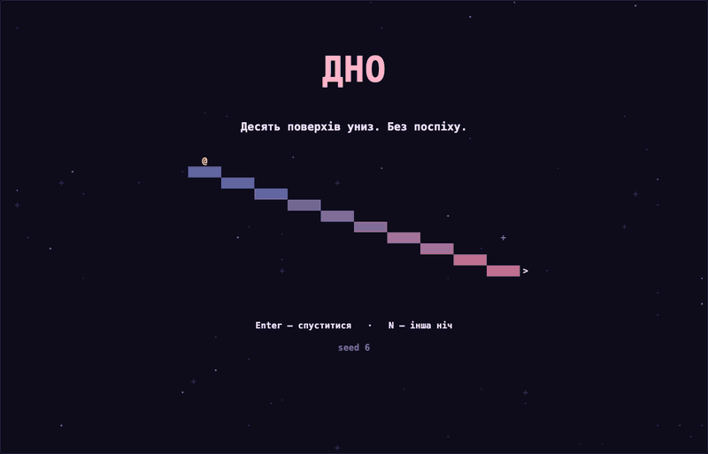
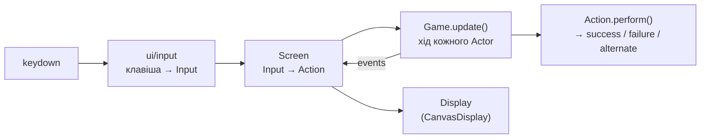
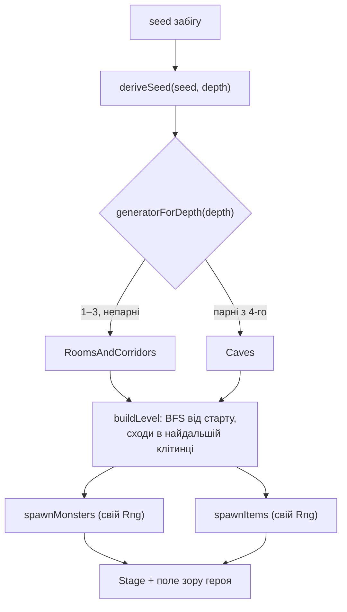

# ДНО

Покрокова roguelike-гра в браузері з процедурною генерацією підземель: десять поверхів униз, крізь власні нав'язливі думки.
Семестровий проєкт з дисципліни JavaScript — [Lab 26: Procedural Roguelike](https://github.com/rmalkevy/Programming-Practice-Projects/blob/main/labs/lab-26-procedural-roguelike.md) програми «42».

**▶ Грати:** https://old7evenn.github.io/roguelike/



<sub>Seed 6, перші чотири поверхи. Цей запис — не ручна гра: бот зіграв seed у тестах, а його натискання відтворено в браузері, і гра прийшла в ту саму точку. Так виглядає детермінізм.</sub>

> Кожен забіг має **seed**. Однаковий seed — однакове підземелля на всіх 10 поверхах.
> Посилання виду `…/?seed=1234` можна надіслати другу, і він пройде ті самі поверхи.

## Керування

| Клавіша | Дія |
|---|---|
| WASD / стрілки / numpad | рух; крок у монстра — удар, на предмет — підібрати |
| клік / тап по карті | іти туди найкоротшим шляхом; по сусідньому монстру — удар, по собі — чекати |
| X | дослідити поверх: герой сам іде до найближчого предмета чи недослідженого місця |
| E | іти до сходів, якщо їх уже видно |
| `.` | пропустити хід |
| I | речі: ↑↓ вибрати, Enter — випити або взяти в руки, Esc — закрити |
| M | увімкнути або вимкнути звук (вибір зберігається) |
| Enter / пробіл | почати гру, підтвердити |
| N | новий забіг з випадковим seed |

Автохід (клік, X, E) зупиняється, щойно в полі зору з'являється монстр, а X і E не почнуться, поки він поруч: гра не заводить героя в бійку на автопілоті. Будь-яка клавіша теж зупиняє автохід.

**Що є що на карті.** Герой — світлий кружок з `@`. Монстри — привиди з очима: колір і розмір залежать від породи, поранені мають смужку HP. Предмети — чашки (лікують) і палички (зброя). Сходи — `>` на підсвіченій клітинці. Бічна панель праворуч показує HP, усіх монстрів у полі зору з їхнім HP, предмети поруч, а під курсором — що це за клітинка чи істота.

На телефоні під полем з'являються кнопки з тими самими діями, а тап по карті веде героя туди.

**Мета:** спуститися на 10-й поверх і перемогти там *відчай* (великий рогатий привид). На останньому поверсі сходів немає.

## Запуск локально

```bash
nvm use        # Node 24 (.nvmrc)
npm install
npm run dev    # http://localhost:5173
npm test       # Vitest
npm run balance  # бот грає 200 забігів і звітує, скільки виграв
npm run lint   # Biome: лінтер + форматування
npm run build  # продакшн-збірка в dist/
```

## Архітектура

Три шари із залежностями тільки згори вниз. `world/` нічого не знає про браузер, тому вся логіка гри тестується в Node без canvas.

```
src/
├── engine/       загальні будівельні блоки, без знань про гру
│                 Vec, Rect, Array2D, Rng, EventBus, distanceMap (BFS), fieldOfView (shadowcasting)
├── world/        модель гри: Game, Stage, Actor/Hero/Monster, тайли, породи, предмети, дії, поведінки
├── generation/   генератори (кімнати, печери), вибір генератора за глибиною, збирання рівня, спавн
├── ui/           Display, екрани, журнал повідомлень, клавіші, тема
└── main.ts       точка складання: створює Display і Ui, запускає цикл
```



### Патерни і навіщо вони тут

| Патерн | Де | Яку проблему розв'язує |
|---|---|---|
| **Command** | `world/actions/*` | Хід — це об'єкт `Action`. Ігровий цикл однаково виконує дії гравця й монстрів, і нова механіка — це новий клас, а не ще одна гілка `switch`. |
| **Alternate action** (різновид Command) | `ActionResult.alternate` | Дія може замість себе запустити іншу: крок на сходи стає спуском, крок у монстра — атакою (`AttackAction`), крок на предмет закінчується підбиранням. Шар введення про це не знає. |
| **Type Object** | `world/tile.ts`, `world/breeds.ts`, `world/items.ts` | Тайл — спільний незмінний об'єкт `TileType` із властивостями (`isWalkable`, `isExit`), а не магічне число. Порода `Breed` так само зберігає все спільне для виду монстрів (HP, атака, поведінка, глибина появи), а `Monster` — лише своє: позицію й поточне HP. Предмет `ItemType` взагалі не має власного стану, тож інвентар зберігає самі спільні об'єкти. Новий тайл, монстр чи предмет — це новий запис, а не нові `if` чи підкласи. |
| **Strategy** | `generation/*`, `world/behaviors/*` | `Game` залежить тільки від інтерфейсу `DungeonGenerator`, а `generatorForDepth` вирішує, якому поверху кімнати (`RoomsAndCorridors`), а якому печери (`Caves`). Монстр так само делегує вибір ходу `Behavior`: `ChaseBehavior` іде до героя по карті відстаней, `WanderBehavior` блукає, `BossBehavior` переходить у другу фазу й кличе підмогу. |
| **Observer** | `engine/event-bus.ts` | Світ повідомляє, що сталося (`message`, `attack`, `death`, `itemPickedUp`, `summon`, `defeat`, `victory`…), і не знає, хто слухає: журнал (`MessageLog`), екран чи бот у тестах. |
| **State** | `ui/screens/*` | Кожен екран (титул, гра, інвентар, перемога, поразка) сам обробляє введення і малює себе. `Ui` тримає стек екранів: інвентар кладеться поверх гри, і гру видно за ним. Без `if (screen === ...)` по всьому коду. |
| **Game Loop + Dirty Flag** | `main.ts`, `ui/ui.ts` | `requestAnimationFrame` крутиться постійно, але перемальовує тільки після змін, бо гра покрокова. |

Основу взято з [Game Programming Patterns](https://gameprogrammingpatterns.com/) і доповіді Bob Nystrom [«Is There More to Game Architecture than ECS?»](https://www.youtube.com/watch?v=JxI3Eu5DPwE) (Roguelike Celebration 2018). ECS свідомо не використовую: для покрокової гри з десятками сутностей це зайва складність, і композиції з Command достатньо.

### Чому Canvas 2D, а не three.js чи ігровий рушій

- **three.js** — це 3D-бібліотека для рендерингу, а не ігровий рушій. Для покрокової 2D-гри на сітці вона додає камеру, освітлення, сцену і 3D-моделі, але нічого не дає для головного в цій лабі: генерації, ШІ ворогів і бою.
- **Phaser** — повноцінний 2D-рушій, але свій ігровий цикл, сцени і фізику він ховає всередині. На захисті треба пояснювати, як усе працює, тому прихована «магія» тут заважає.
- **Canvas 2D** не потребує залежностей, а весь рендер — один клас `CanvasDisplay`.
- Екрани малюють тільки через інтерфейс `Display`. Якщо лишиться час, можна додати інший бекенд (наприклад, three.js для 2.5D) як Side Quest, не чіпаючи гру.

### Як працює генерація

Поверхи 1–3 — кімнати. З 4-го чим глибше, тим більше плутаються думки: на парних поверхах печери, на непарних кімнати. 10-й поверх — завжди печера, широка арена для боса.



**Кімнати й коридори** (`generation/rooms-and-corridors.ts`) — класичний Rogue 1980 року:
1. Уся карта заповнюється стінами.
2. До `maxRooms × 10` спроб поставити кімнату випадкового розміру; спроби, що перетинаються з іншими кімнатами (з відступом 1), відкидаються.
3. Кожна нова кімната з'єднується L-подібним коридором з попередньою, тому граф кімнат — ланцюжок, і він завжди зв'язний.

**Печери** (`generation/caves.ts`) — клітинні автомати:
1. Шум: кожна клітинка всередині рамки — скеля з імовірністю 50%.
2. Чотири кроки згладжування за правилом 4-5: клітинка з 5+ сусідами-скелями стає скелею, з 3 і менше — підлогою, з 4 лишається як є. Шум злипається в округлі зали.
3. Flood fill знаходить усі зв'язні області; лишається тільки найбільша, решта заливається скелею. Без цього кроку старт і сходи могли б опинитися в різних «кишенях».
4. Якщо печера займає менше 30% карти, вона генерується заново з того самого потоку `Rng`, тож результат усе одно визначає seed.

**Спільне для обох** (`generation/level.ts`): `buildLevel` запускає BFS від старту й ставить сходи `>` у найдальшій досяжній клітинці. Seed поверху = `deriveSeed(runSeed, depth)`, тож поверх 5 не залежить від того, що відбувалося на поверхах 1–4.

**Захист від softlock:** тест для кожного генератора проганяє 500 seed і перевіряє, що кожна прохідна клітинка досяжна зі старту, а сходи існують і не збігаються зі стартом.

### Поле зору і туман війни

`engine/field-of-view.ts` — recursive shadowcasting (Björn Bergström, RogueBasin). Коло навколо героя ділиться на 8 октантів; один октант сканується рядами від героя, видима частина ряду — інтервал нахилів. Стіна ділить інтервал: частину за нею рекурсивний виклик сканує далі, а решта ряду продовжується. Вісім октантів — це той самий код з різними множниками координат.

`Stage` пам'ятає, що видно зараз і що герой бачив колись. Досліджене поза полем зору малюється тьмяно, а монстри й предмети — тільки в полі зору. Монстри полем зору не користуються: вони «чують» героя на відстані кількох кроків по коридорах, тож можуть підкрастися з темряви.

### Бій і баланс

Удар: `атака − захист ± 1`, але не менше 1. Кожен спуск додає герою 5 макс. HP (одразу заповнених). Зброя додає атаку, зілля лікують. Актор отримує за свій хід `speed` енергії та витрачає 100 на дію: герой і більшість монстрів мають швидкість 100, «неспокій» — 125, а «тягар» — 75.

Баланс перевірено не на око. `tests/bot.ts` — бот, що грає цілий забіг за простими правилами: б'є все поруч, п'є при HP нижче 40%, бере кращу зброю, збирає предмети поруч, інакше йде до сходів або до боса. Бот знає всю карту, але ніколи не відступає й не береже зілля, тож людина має грати не гірше.

`npm run balance` проганяє 200 seed і показує, скільки забігів виграно, на якій глибині й від кого гине бот. Перший прогін дав 0 перемог з 20, і більшість смертей — від *тягаря* на 8–10 поверхах. Після зростання героя й послаблення тягаря та боса бот вигравав **91 з 200 (46%)**. Система швидкості змінила результат на **109 з 200 (55%)**, `stuck 0`: повільний тягар убиває рідше, але смерті досі зосереджені на 8–10 поверхах (тягар, спогад, відчай), тож складність росте до кінця. Звичайний `npm test` проганяє 20 seed і падає, якщо частка перемог виходить за 15–80%: зламаний баланс ловиться так само, як зламаний код.

## План і прогрес

Детальний план реалізації: [docs/ROADMAP.md](docs/ROADMAP.md).

### Basic — «It Generates»
- [x] 2D-сітка й рендер (ASCII на canvas)
- [x] процедурна генерація поверху
- [x] рух гравця, стіни блокують
- [x] сходи генерують наступний поверх
- [x] 10 поверхів, перемога на останньому
- [x] seed у URL, детермінізм покрито тестами
- [x] деплой на GitHub Pages

### Standard — «It's a Real Roguelike»
- [x] вороги (≥2 типи), що рухаються до гравця
- [x] бій «bump-to-attack», HP гравця й ворогів, смерть → екран поразки
- [x] предмети: зілля, зброя; інвентар
- [x] журнал повідомлень
- [x] баланс перевірено ботом на 200 seed (`npm run balance`)
- [ ] гру пройшла хоча б одна людина, крім мене

### Advanced — «It Has Depth» (обрати 2–3)
- [x] поле зору / туман війни (shadowcasting)
- [ ] A* для ворогів
- [x] другий генератор: cellular automata для печер
- [x] фінальний бос з двома фазами
- [x] звукові ефекти (Web Audio API)
- [x] система енергії: швидкі й повільні монстри
- [ ] рендерер на three.js як альтернативний вигляд
- [x] мобільна версія: кнопки на сенсорних екранах

### Make it yours

**Тема.** Спуск на дно — це спуск у власну голову, а монстри — нав'язливі думки: *шепіт*, *неспокій* (не переслідує, а просто блукає), *докір*, *спогад* і *тягар*. Кожен намальований привидом свого кольору; що небезпечніший, то більший (`theme.monsters`, малює `CanvasDisplay.drawSprite`). Палітра й настрій навіяні Celeste, але без запозичених персонажів, назв і графіки.

**Візуальний стиль.** Палітра змінюється з глибиною: перший поверх — холодна синя ніч, десятий — тепла рожева зоря (`tileGlyphs(depth)` у `ui/theme.ts` змішує дві палітри). Титульний екран показує весь спуск як сходи з десяти сходинок у кольорах поверхів. Стіни — суцільні блоки замість `#`, тож кімнати читаються як силуети.

**Власна механіка: тунельний зір.** Що менше в тебе HP, то менше світу ти бачиш: радіус огляду лінійно падає від 8 клітинок при повному здоров'ї до 3 на останньому HP (`Hero.sightRadius`). Так у грі працює тривога: коли тобі погано, світ звужується до кількох кроків, і думки підкрадаються з темряви непомітно. Чашка чаю буквально розширює погляд. Механіка змінює тактику: поранений гравець не бачить, що чекає за рогом, тож вчасно лікуватися — не тільки про HP, а й про інформацію. У бічній панелі видно поточний «огляд».

**Фінал.** На дні чекає *відчай* (великий рогатий привид), єдиний монстр, що відчуває героя з будь-якої точки поверху. Поки в нього більше половини HP, він просто полює. Потім переходить у другу фазу: кожен третій хід кличе шепіт замість кроку. Сходів на останньому поверсі немає: вийти можна, тільки здолавши його.

## Відомі обмеження

- Shadowcasting Бергстрема несиметричний: зрідка стіну видно з одного боку під кутом, а з іншого ні. Монстри полем зору не користуються, тож на чесність бою це не впливає.
- Немає збереження: забіг живе, поки відкрита вкладка (зате seed у URL дозволяє повторити підземелля).
- Бот-баланс оцінює гру знизу: людина відступає й береже зілля, тож реальна складність нижча.

## Що я дізнався

> Чернетка: перепиши своїми словами перед захистом.

- **Детермінізм — це дисципліна, а не функція.** Одного `Math.random()` у світі гри достатньо, щоб seed перестав працювати. Окремі потоки `Rng` для карти, монстрів і предметів (`deriveSeed`) означають, що зміна балансу предметів не перебудовує карту, а повтор забігу в браузері збігається з тестом у Node до ходу.
- **Генерація — це тільки половина; друга половина — перевірка.** Клітинні автомати красиві, але без flood fill дають недосяжні сходи. Тест на 500 seed знаходить такі випадки за секунди, а очима їх не знайти ніколи.
- **Command + alternate action** прибрали з введення всі `if`: крок у монстра, на сходи чи на предмет — це та сама `WalkAction`, яка вирішує, чим вона стане.
- **Type Object** зробив баланс справою даних: послабити тягаря — змінити два числа в таблиці, а не код.
- **Бот як тест балансу.** «Гра проходима» стало твердженням, яке можна перевірити й зламати, а таблиця «хто вбив» одразу показала, що проблема в одному монстрі, а не в грі загалом.
- **Shadowcasting** — рекурсія по нахилах, а не по клітинках; один октант і вісім перетворень координат замість восьми копій коду.
