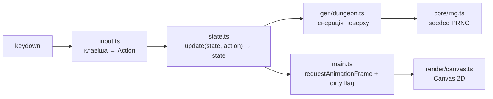

# Roguelike

Покрокова roguelike-гра в браузері з процедурною генерацією підземель.
Семестровий проєкт з дисципліни JavaScript — [Lab 26: Procedural Roguelike](https://github.com/rmalkevy/Programming-Practice-Projects/blob/main/labs/lab-26-procedural-roguelike.md) програми «42».

**▶ Грати:** https://old7evenn.github.io/roguelike/

> Кожен забіг має **seed**. Однаковий seed — однакове підземелля на всіх 10 поверхах.
> Посилання виду `…/?seed=1234` можна надіслати другу, і він пройде ті самі поверхи.

## Керування

| Клавіша | Дія |
|---|---|
| WASD / стрілки | рух |
| `.` або пробіл | пропустити хід |
| Enter | почати гру |
| N | новий забіг з випадковим seed |

## Запуск локально

```bash
nvm use        # Node 24 (.nvmrc)
npm install
npm run dev    # http://localhost:5173
npm test       # Vitest
npm run build  # продакшн-збірка в dist/
```

## Архітектура



| Модуль | Відповідальність |
|---|---|
| `src/core/rng.ts` | детермінований PRNG (mulberry32), `deriveSeed` для окремого seed кожного поверху |
| `src/core/grid.ts` | карта поверху як плоский `Uint8Array` |
| `src/gen/dungeon.ts` | алгоритм «кімнати + L-коридори» |
| `src/gen/connectivity.ts` | BFS: сходи в найдальшій точці, перевірка зв'язності |
| `src/game/state.ts` | стан гри і чиста функція `update` |
| `src/game/input.ts` | `event.code` → дія (працює на будь-якій розкладці) |
| `src/render/*` | інтерфейс `Renderer` і його реалізація на Canvas 2D |

### Чому Canvas 2D, а не three.js чи ігровий рушій

- **three.js** — це 3D-бібліотека для рендерингу, а не ігровий рушій. Для покрокової 2D-гри на сітці вона додає камеру, освітлення, сцену і 3D-моделі, але нічого не дає для головного в цій лабі: генерації, ШІ ворогів і бою.
- **Phaser** — повноцінний 2D-рушій, але свій ігровий цикл, сцени і фізику він ховає всередині. На захисті треба пояснювати, як усе працює, тому прихована «магія» тут заважає.
- **Canvas 2D** не потребує залежностей, а рендер займає ~100 рядків. Увесь код свій, і його можна пояснити.
- Логіка гри не залежить від рендерера (інтерфейс `Renderer`). Якщо лишиться час, можна додати другий рендерер на three.js (2.5D-підземелля) як Side Quest, не чіпаючи гру.

### Як працює генерація

1. Уся карта заповнюється стінами.
2. До `maxRooms × 10` спроб поставити кімнату випадкового розміру; спроби, що перетинаються з іншими кімнатами (з відступом 1), відкидаються.
3. Кожна нова кімната з'єднується L-подібним коридором з попередньою, тому граф кімнат — ланцюжок, і він завжди зв'язний.
4. BFS від старту знаходить найдальшу клітинку, там ставимо сходи `>`.
5. Seed поверху = `deriveSeed(runSeed, floorIndex)`, тож поверх 5 не залежить від того, що відбувалося на поверхах 1–4.

**Захист від softlock:** тест генерує 1000 поверхів і перевіряє, що кожна прохідна клітинка досяжна зі старту, а сходи існують і не збігаються зі стартом.

## План і прогрес

### Basic — «It Generates»
- [x] 2D-сітка й рендер (ASCII на canvas)
- [x] процедурна генерація поверху
- [x] рух гравця, стіни блокують
- [x] сходи генерують наступний поверх
- [x] 10 поверхів, перемога на останньому
- [x] seed у URL, детермінізм покрито тестами
- [x] деплой на GitHub Pages

### Standard — «It's a Real Roguelike»
- [ ] вороги (≥2 типи), що рухаються до гравця
- [ ] бій «bump-to-attack», HP гравця й ворогів, смерть → екран поразки
- [ ] предмети: зілля, зброя; інвентар
- [ ] журнал повідомлень
- [ ] гру пройшла хоча б одна людина, крім мене

### Advanced — «It Has Depth» (обрати 2–3)
- [ ] поле зору / туман війни (shadowcasting)
- [ ] A* для ворогів
- [ ] другий генератор: BSP або cellular automata для печер
- [ ] фінальний бос
- [ ] звук і музика (Web Audio)
- [ ] рендерер на three.js як альтернативний вигляд

### Make it yours
_Тут буде особливість, якої немає в типовому туторіалі, і тема гри._

## Що я дізнався

_Заповнюється по ходу роботи._
